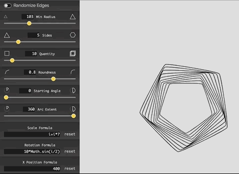
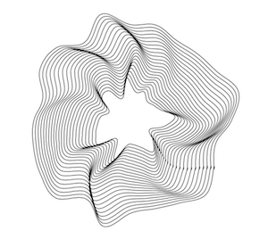
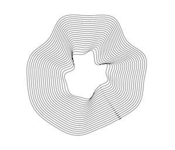
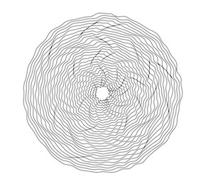
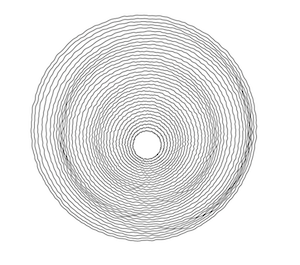

# Rad Lines

> **This tool has moved!** Rad Lines is now hosted at **[drawingbots.com/tools/rad-lines](https://drawingbots.com/tools/rad-lines/)**. The old GitHub Pages URL (`msurguy.github.io/rad-lines`) now shows a notice and redirects there — the `docs/` folder in this repo contains that redirect page, not the app. Rebuilding with `yarn build` would overwrite it with the old app, so don't rebuild unless you intend to undo the redirect.

Rad Lines: Create Plotter-Friendly SVG Patterns Instantly

Design unique, plotter-ready SVG patterns with customizable shapes, rotation formulas, and more. Instantly download your creations for use with CNC, laser cutters, or drawing robots.

# Interface demo



# Samples

Here are some samples of artworks created with this tool:






# Support Creator

If you find this tool useful, I'd like to encourage you to support my efforts by buying me coffee or giving any other amount on these platforms:

- Patreon: https://www.patreon.com/msurguy
- Open Collective: https://opencollective.com/drawingbots-community
- Ko-Fi: https://ko-fi.com/msurguy

## Build Setup

``` bash
# install dependencies
yarn install

# serve with hot reload
yarn run dev

# build for production with minification
yarn run build
```
